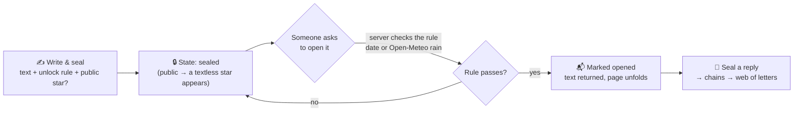

<div align="center">


<a href="https://github.com/heyytejaswini/Starstamp">

</a>

<br><br>

<a href="https://github.com/heyytejaswini"></a>
<a href="https://www.linkedin.com/in/heyytejaswini/"></a>

</div>

---

## ✦ Hello, I'm Tejaswini

First-year **BCA student at CHRIST (Deemed to be University), Bengaluru**, working where **software, AI, research and design** meet.

I like understanding *how* something works, and also *how it feels to use it*: the structure of a website, how information gets discovered, how an AI system retrieves and communicates what it knows.

> *I like building things that work, and I care that they feel, flow and communicate.*

<table>
<tr>
<td width="50%" valign="top">

**🌐 Web & Digital Experience**
Full-stack development · UI/UX · information architecture · content structuring · interactive experiences

</td>
<td width="50%" valign="top">

**🤖 AI & Emerging Tech**
LLMs · RAG · agentic AI · intelligent information retrieval · robotics · GPU-accelerated computing

</td>
</tr>
</table>

---

## 🌠 Featured: Starstamp

<div align="center">

### *write a letter. seal it. let the sky decide when it opens.*

</div>

**Starstamp** is a web app for time-locked letters. You write a letter and seal it with an unlock rule: a **date**, or something like **"when it rains in my city."** You can choose to turn the letter into a **star** in a shared sky. The star shows that a letter exists but never what it says. When the rule is met, the letter unfolds. Letters can also be answered with sealed replies, which form chains that grow into a **web of letters**.

`🚧 In Progress`

### The stack, in plain words

| Part | Tool | Its job in Starstamp |
|---|---|---|
| **Frontend** | Next.js · React · Tailwind | The sky, the writing desk, *My Letters* |
| **Animation** | Canvas · GSAP · Framer Motion | Falling stars, the hourglass, pages unfolding |
| **Backend** | Next.js server code on Vercel | Anything that must be trusted: saving letters, checking if one can open |
| **Database** | Supabase Postgres | Letters, stars, lights |
| **Auth** | Supabase Auth | Email-link or Google sign-in |
| **Realtime** | Supabase Realtime | Live shooting stars and who's online |
| **Weather** | Open-Meteo API | "Is it raining in this city right now?" |

### The life of a letter



### Design decisions I'm proud of

- **The browser is never trusted.** Anyone can open DevTools and tamper with what a page sends, so *"you can't read a sealed letter"* is enforced by the database itself with **Row Level Security (RLS)**, not by hiding things in the UI.
- **Lazy checking.** Nothing ticks in the background. The server tests the unlock rule only when someone asks to open a letter, so version 1 needs no scheduler.
- **Stretch goal:** "your letter can open now" emails, which will need scheduled jobs. I'll check the current Vercel plan limits before relying on them.

---

## ✦ Other Things I've Built

<table>
<tr>
<td width="50%" valign="top">

### ☕ Brew & Bloom Café
`HTML` `CSS` `JavaScript` `React` `Node.js` `Express` `MySQL` `MongoDB`

A full-stack café website concept about navigation, visual hierarchy and structured content: responsive design, interactive forms, database connectivity, and sustainability / SDG-linked content.
`🚧 In Progress`

</td>
<td width="50%" valign="top">

### 🌙 Lumé
`HTML` `CSS` `JavaScript` `Git`

A productivity and wellness app with Pomodoro focus sessions, task management and structured break activities, exploring external API integrations. Built around simplicity and user flow.

</td>
</tr>
<tr>
<td width="50%" valign="top">

### 🎮 Unity 2D Shooter
`Unity` `2D game dev`

A functional 2D shooter. I worked on level design, gameplay mechanics, collision and physics, scoring, UI and playtesting, on top of an existing C# framework.

</td>
<td width="50%" valign="top">

### 🗑️ Automatic E-Dustbin
`Arduino UNO` `HC-SR04` `Servo`

A sensor-driven dustbin: ultrasonic detection triggers servo-controlled lid movement. A small project in hardware, logic and accessibility-minded design.

</td>
</tr>
</table>

<sub>Coursework also covers AngularJS, React, SQL/MySQL, MongoDB, Node.js and Express: controllers, data binding, event handling, forms and database integration.</sub>

---

## 🤖 AI × HPC

**Enterprise AI / HPC Bootcamp 2026**, Centre for AI, CHRIST (Deemed to be University): hands-on work with **NVIDIA H100** GPU-based AI workflows.

| Area | Exposure |
|---|---|
| GPU computing | NVIDIA H100 |
| AI frameworks | NVIDIA NeMo |
| Model adaptation | QLoRA / fine-tuning |
| Accelerated computing | RAPIDS |

`AI models → model adaptation → GPU infrastructure → accelerated workflows → practical applications`

### 🔬 Research interest

> **Evaluating RAG Systems for Reducing Hallucinations in Educational Question Answering**

- How does retrieval affect factual reliability?
- Why do LLMs hallucinate even on knowledge-based questions?
- How can external knowledge improve grounding?
- How should RAG systems be evaluated in educational settings?
- Where can agentic systems improve information retrieval?

---

## 🏛️ Experience

| Role | Where | When |
|---|---|---|
| **AI / HPC Intern & Peer Trainer** | Centre for AI, CHRIST University | 2026 – Present |
| **IT Support Intern** | Office of IT Services, CHRIST University | Jul 2026 – Present |
| **Management Intern** (Team Head) | Office of Admissions, CHRIST Central Campus | 185+ hrs of service across 1st and 2nd PUC |
| **Business Development Specialist Intern** | Younity | 2024 |

<details>
<summary><b>What I did in each role</b></summary>

<br>

**Centre for AI.** Worked with NeMo, QLoRA/fine-tuning and RAPIDS on H100s; took part in technical learning and knowledge-sharing; built an understanding of AI infrastructure and accelerated workflows.

**Office of IT Services.** Backend operations, technical documentation and institutional IT workflows; supported technology needs across the university.

**Office of Admissions.** Handled student and parent queries, assisted with admission processes, coordinated floor operations in high-footfall periods and led a team.

**Younity.** Client outreach and business-development calls; professional communication and stakeholder interaction.

</details>

---

## 📌 Digital Content & Design

<div align="center">

| `4.2M+` | `2M+` |
|:---:|:---:|
| Pinterest impressions | Audience reach |

</div>

Content work built on **visual communication, discoverability, trend analysis and digital storytelling**. Design tools: **Canva** (graphics, social, presentations) and **Figma** (basic UI, layout and interface structure).

### 🧠 Information, by design

```text
Research → Information → Structure → Design → Communication → Discovery
```

I'm drawn to academic websites, research communication and information-heavy interfaces, and I want to make complex information **clearer, more navigable and more human**.

---

## 🧩 Tech Stack

<p>


</p>

---

## 🧭 How I Work

**01 Understand** the problem, user and context → **02 Structure** it: *information → flow → interface → functionality* → **03 Build** something interactive → **04 Question** what works and why → **05 Improve** until it's clearer, more useful and more enjoyable.

---

## 🎓 Education, Certifications & Beyond

<details>
<summary><b>🎓 Education</b></summary>

<br>

- **BCA**, CHRIST (Deemed to be University), Bengaluru, 2026 – Present. Web & backend, C/C++, digital logic, databases, research writing, AI, DSA.
- **PUC (PCMC)**, Christ Junior College, Karnataka State Board, 2025
- **SSLC**, Madonna High School, Karnataka State Board, 2023: **96.96%**

</details>

<details>
<summary><b>📜 Certifications & learning</b></summary>

<br>

Harvard **CS50x** · Enterprise AI / HPC Bootcamp 2026 (Centre for AI, CHRIST) · NVIDIA H100 GPU-based AI training · NVIDIA NeMo · QLoRA / fine-tuning · RAPIDS · Data Artisan Bootcamp 2026 · Cadet Training Program

</details>

<details>
<summary><b>🎤 Events & engagement</b></summary>

<br>

**Emcee** at **IEEE ICONICA 2026** and the **SDG International Conference** (in association with Sophia University, Japan), plus AI, research and technology events: operations, hospitality, logistics and student engagement.

</details>

<details>
<summary><b>🪖 NCC · 🏅 Sports</b></summary>

<br>

**NCC B Certificate** (Christ Junior College, 2 years). Participated in IGC; 🥇 Gold Medal in Dance; represented 2/9 Coy NCC in Rifle Shooting at IGC Karnataka & Goa Directorate.
**Volleyball:** 🥇 District gold, state-level representation. **Throwball:** 🥇 District gold.

</details>

<details>
<summary><b>🌏 Languages</b></summary>

<br>

English (Professional) · Kannada, Hindi, Telugu (Fluent) · French (A1) · Mandarin Chinese (HSK 1)

</details>

<details>
<summary><b>🌱 Outside the terminal</b></summary>

<br>

Dancing · journaling · digital creation · game development · robotics · visual design · Pinterest curation

</details>

---

## 🎯 Where I'm Headed

I'm building a foundation across **software engineering, AI, research, design and information**, with the aim of making technology that's not only capable but **thoughtful, accessible and genuinely useful.**

---

<div align="center">


<br><br>

### 🩵 Let's connect
Web development · AI · research · design · emerging technology

<a href="https://github.com/heyytejaswini"></a>
<a href="https://www.linkedin.com/in/heyytejaswini/"></a>

<br>

`curious mind → messy first draft → better version → repeat`


</div>

<!-- Made with curiosity, caffeine, and too many browser tabs. 🩵 -->
